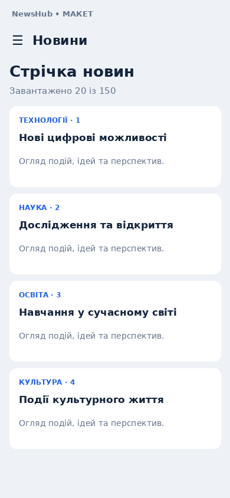

# Лабораторна робота №2 — NewsHub

## Тема
Віртуалізація списків та побудова навігації.

## Мета
Опанувати оптимізацію списків та вкладену навігацію із захистом маршрутів у Expo Router.

## Запуск
Потрібні Node.js та середовище, сумісне з Expo SDK 54.

```bash
npm install
npx expo start
```
За потреби: `npx expo start --clear` або `npx expo start --tunnel`.
Для перевірки сумісності залежностей: `npx expo install --fix` та `npx expo-doctor`.
SDK 54 обрано як базову версію; актуальність SDK на дату здачі не перевірено. Для нового проєкту методичка передбачає `npx create-expo-app@latest` та `npm run reset-project`; цей архів уже містить готові вихідні файли.

## Функціональність
- AuthContext: isAuthenticated, login(), logout(). Демонстраційний вхід з будь-якими непорожніми даними, без сервера.
- Публічний login та захищений Drawer із Redirect.
- Вкладений Stack без дублювання заголовка.
- 150 локальних демонстраційних новин, FlatList, порції по 20, Pull-to-Refresh, Infinite Scroll, getItemLayout та React.memo.
- Динамічний маршрут [id] та useLocalSearchParams.
- FAQ із SectionList, Safe Areas.

## Демонстрація інтерфейсу
Нижче наведено макети, а не скриншоти фактичного запуску. Після запуску замініть їх власними знімками.

<p align="center">
  
  
  
</p>

<p align="center">
  
  
</p>


## Перевірка роботи
1. Відкрити застосунок, перевірити екран входу та помилку порожніх полів.
2. Увійти, перевірити стрічку та відкриття новини.
3. Прокрутити до кінця порції: лічильник має збільшитися. Потягнути вниз: лічильник має повернутися до 20.
4. Відкрити Drawer, перейти до FAQ та вийти. Перевірити перенаправлення на login.

## Контрольні запитання
1. Вкладена навігація: файли `_layout.jsx` визначають навігатори для дочірніх маршрутів; групи в дужках організовують маршрути без додавання сегмента URL. Stack новин вкладено в Drawer.
2. Захист: AuthContext зберігає стан входу, а layout Drawer повертає Redirect на login, якщо isAuthenticated є false. Це демонстраційний клієнтський захист, не серверна безпека.
3. ScrollView створює всі дочірні елементи, FlatList віртуалізує список, рендерячи переважно видимі елементи та сусіднє вікно. Це зменшує витрати пам’яті та рендерингу.
4. Параметр динамічного маршруту `[id].jsx` отримують через `const { id } = useLocalSearchParams()`.
5. SectionList приймає масив секцій, кожна з яких має масив `data` та може містити заголовок `title`, наприклад `[{title: 'Новини', data: [{q: 'Питання', a: 'Відповідь'}]}]`.

## Висновок
У вихідному коді реалізовано демонстраційну авторизацію, вкладені маршрути та віртуалізовані списки. Фактичний запуск і тестування на пристрої ще потрібно виконати.

## Репозиторій
Планована адреса: https://github.com/beautymental/MobileLabsRN2026/tree/lab2
