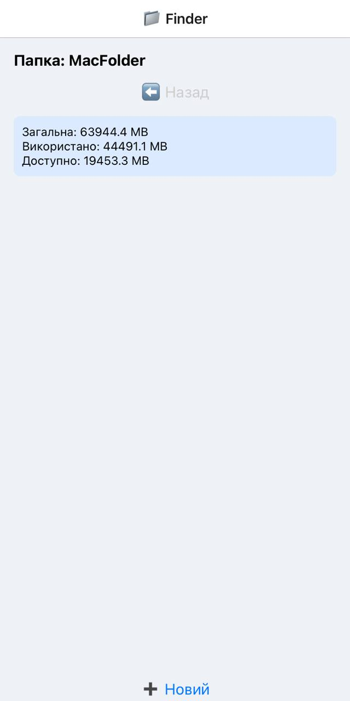
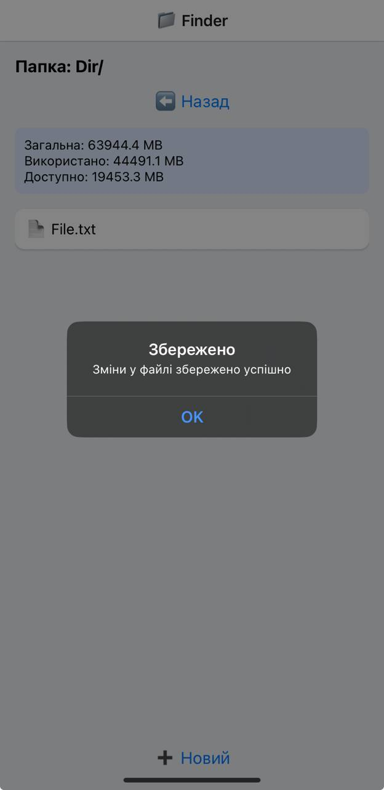
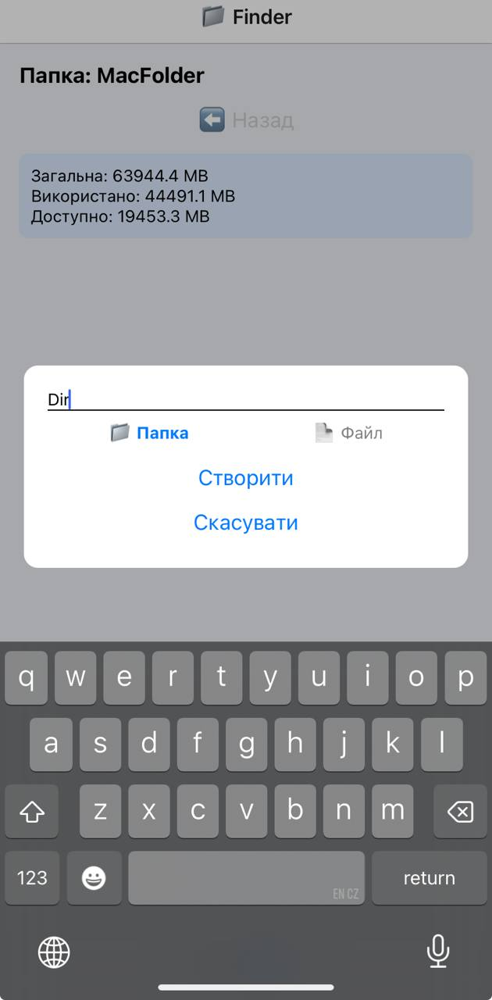
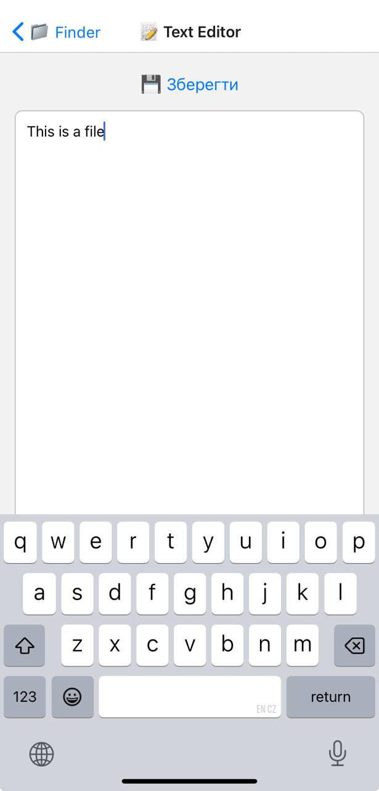
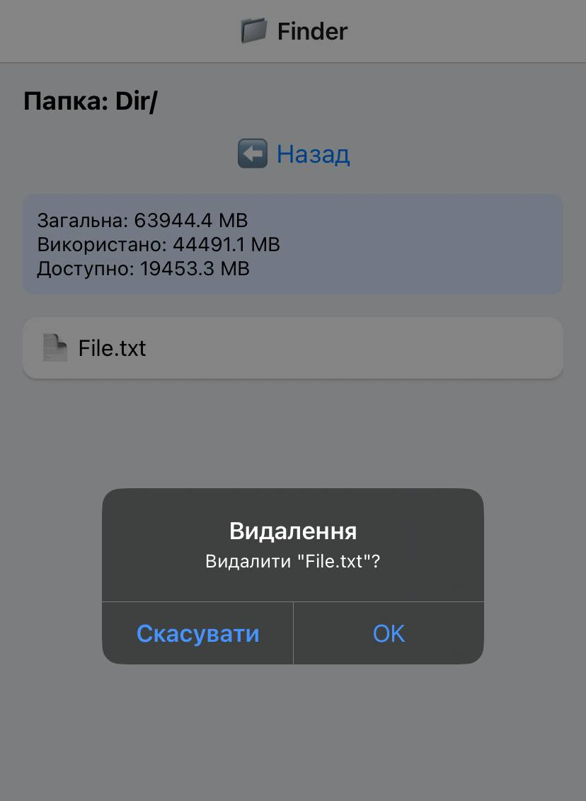

# Лабораторна робота №5 — Файловий менеджер

## Тема роботи

Робота з файловою системою в React Native з використанням бібліотеки expo-file-system.

## Мета роботи

Опанувати механізми роботи з локальною файловою системою мобільного пристрою, закріпити навички реалізації базових операцій над файлами й папками, організації файлової навігації та аналізу стану файлової системи.

## Функціональні можливості

- Відображення загального обсягу пам'яті пристрою.
- Відображення вільного та зайнятого простору.
- Відображення поточного шляху.
- Навігація між директоріями.
- Створення файлів та папок.
- Перегляд вмісту текстових файлів.
- Редагування та збереження текстових файлів.
- Видалення файлів та папок із підтвердженням.
- Перегляд детальної інформації про файли.

## Використані технології

- React Native
- JavaScript
- Expo SDK 53
- expo-file-system
- React Navigation

## Встановлення та запуск

### Клонування репозиторію

```bash
git clone -b lab5 https://github.com/beautymental/MobileLabsRN2026.git
cd MobileLabsRN2026
```

### Встановлення залежностей

```bash
npm ci
```

### Запуск застосунку

```bash
npx expo start
```

### Запуск з очищенням кешу

```bash
npx expo start --clear
```

### Запуск через тунель

```bash
npx expo start --tunnel
```

## Структура проєкту

- `screens/HomeScreen.js` — головний екран файлового менеджера.
- `screens/TextEditorScreen.js` — редактор текстових файлів.
- `components/CreateModal.js` — модальне вікно створення файлів та папок.
- `components/InfoModal.js` — модальне вікно перегляду інформації.
- `screenshots/` — зображення інтерфейсу застосунку.
- `App.js` — головний компонент застосунку.
- `app.json` — конфігурація Expo.
- `package.json` — залежності проєкту.

## Скріншоти та демонстраційні макети

<p align="center">
  
  
  
</p>

<p align="center">
  
  
  
</p>

<p align="center">
  
</p>

Зображення 3 та 6 — демонстраційні макети інтерфейсу.

## Контрольні запитання

### 1. Які основні директорії надає бібліотека expo-file-system і в чому полягає різниця між ними?

Бібліотека expo-file-system надає дві основні директорії:

- `Paths.document` — директорія для тривалого зберігання файлів застосунку.
- `Paths.cache` — директорія для тимчасового зберігання файлів, які можуть бути автоматично видалені операційною системою.

У старому API використовуються `documentDirectory` та `cacheDirectory`.

Основна різниця полягає у призначенні та тривалості зберігання файлів.

### 2. Які базові методи expo-file-system використовуються для читання, запису, створення директорій та видалення файлів і папок?

У сучасному API expo-file-system використовуються такі методи:

- `file.create()` — створення файлу.
- `file.text()` — читання вмісту текстового файлу.
- `file.write()` — запис інформації у файл.
- `directory.create()` — створення директорії.
- `directory.list()` — отримання списку файлів та папок.
- `file.delete()` — видалення файлу.
- `directory.delete()` — видалення директорії.

Методи викликаються на екземплярах класів File та Directory.

### 3. Як отримати метадані про об'єкт файлової системи та інформацію про загальний і вільний обсяг пам'яті пристрою?

Для отримання метаданих файлу використовуються такі властивості:

- `file.name` — назва файлу.
- `file.extension` — розширення файлу.
- `file.size` — розмір файлу.
- `file.modificationTime` — дата останньої модифікації.

Для отримання інформації про пам'ять пристрою використовуються:

- `Paths.totalDiskSpace` — загальний обсяг пам'яті пристрою.
- `Paths.availableDiskSpace` — доступний обсяг пам'яті пристрою.

Зайнятий обсяг пам'яті визначається як різниця між загальним та доступним обсягом пам'яті.

## Висновок

Проєкт демонструє основні принципи роботи з локальною файловою системою мобільного пристрою в React Native, використання файлової навігації, створення, читання, редагування та видалення файлів і папок, отримання метаданих та статистики використання пам'яті пристрою.

Для повної відповідності методичним рекомендаціям 2026 року необхідно перейти на актуальний Expo SDK, сучасний API expo-file-system та Expo Router, доповнити створення файлів початковим вмістом, відображення типу файлу за розширенням та перевірити Safe Areas.

Тестування застосунку ще не підтверджено.

## Репозиторій проєкту

[MobileLabsRN2026 — Лабораторна робота №5](https://github.com/beautymental/MobileLabsRN2026/tree/lab5)


