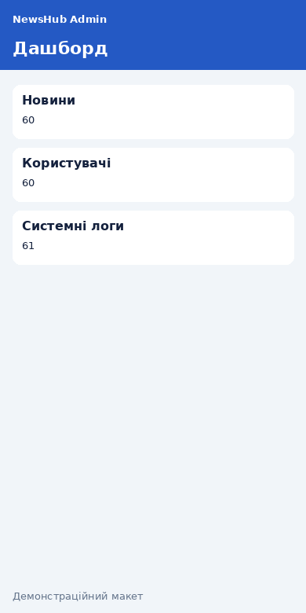
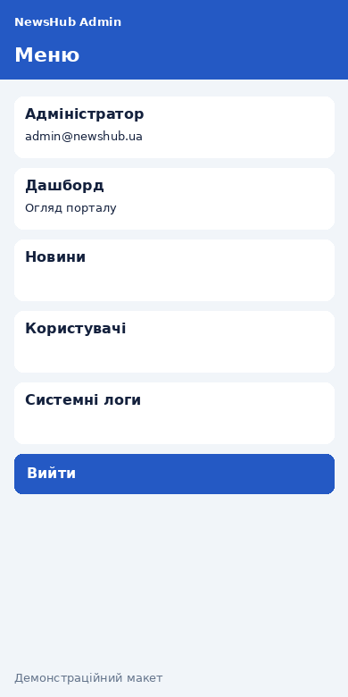
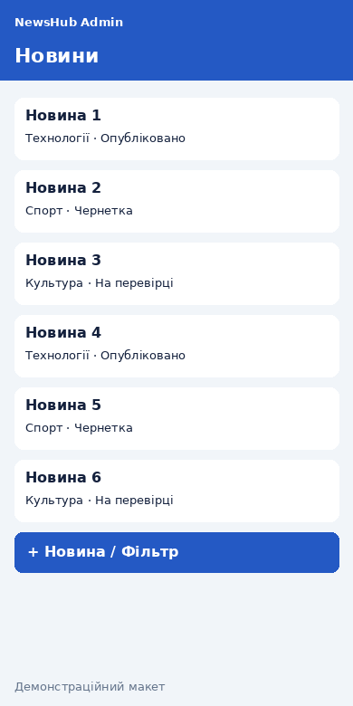
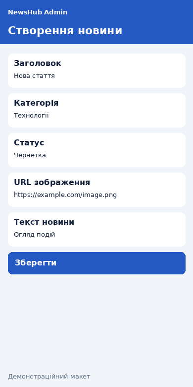
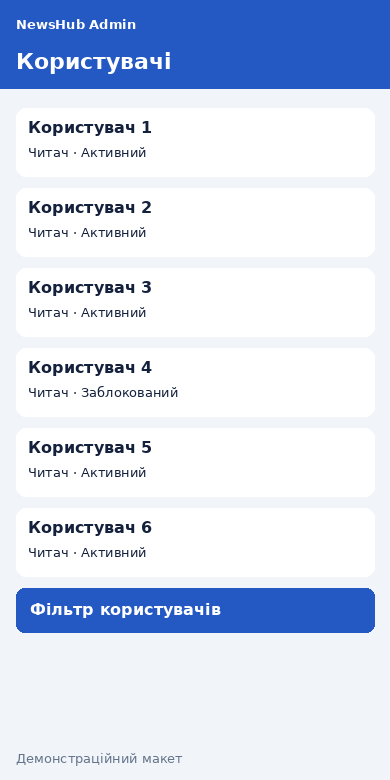
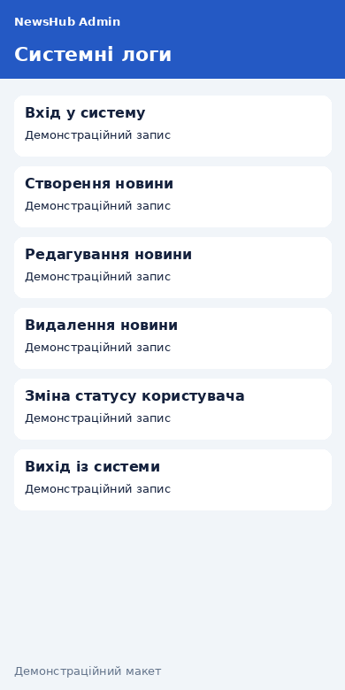
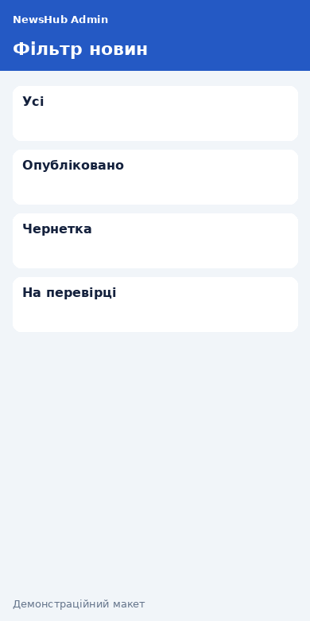

# Лабораторна робота №3 — NewsHub Admin

**Тема:** Expo Router: кастомізація навігаційних компонентів, нативні модальні вікна та віртуалізація списків.

**Мета:** Закріпити навички файлової маршрутизації, ієрархічної навігації та оптимізації списків за допомогою VirtualizedList.

## Функціональність

- Демонстраційна авторизація та захищена група маршрутів `(admin)`.
- Custom Drawer із профілем, чотирма розділами та виходом.
- Дашборд із лічильниками та useFocusEffect.
- По 60 початкових записів новин, користувачів і логів.
- VirtualizedList із getItem, getItemCount, getItemLayout та параметрами пакетного рендерингу.
- Деталі новини `/news/[id]`, створення й редагування у modal, видалення через Alert.alert.
- Зміна статусу користувача; фільтри статусів у formSheet із sheetAllowedDetents.
- Логування лише шести визначених подій: вхід, вихід, створення, редагування, видалення новини, зміна статусу користувача.

Дані зберігаються у локальному React Context до перезапуску застосунку. Серверна авторизація не реалізована: для входу достатньо непорожніх полів.

## Запуск

```bash
npm install
npx expo install --fix
npx expo start
```

За потреби: `npx expo start --clear` або `npx expo start --tunnel`. Базова конфігурація використовує SDK 54; сумісність із поточною версією Expo Go потрібно перевірити. Для перевірки нативних модальних вікон використовуйте Android або iOS.

## Демонстрація інтерфейсу

Нижче наведено статичні демонстраційні макети, а не скриншоти фактичного запуску.

<p align="center">
  
  
  
</p>
<p align="center">
  
  
  
</p>
<p align="center">
  
  
  
</p>

## Перевірка роботи

Увійти, відкрити меню, переглянути дашборд, створити новину, відкрити її деталі, відредагувати та видалити з підтвердженням. Змінити статус користувача, застосувати обидва фільтри, перевірити журнал та оновлені лічильники, вийти. Після повторного входу перевірити лог виходу. Замінити макети фактичними скриншотами після запуску.

## Контрольні запитання

### 1. Як кастомізувати Drawer та хедер Stack?
`drawerContent` приймає функцію, яка повертає власний компонент меню з навігаційними props. `screenOptions.header` дозволяє повернути власний компонент заголовка з options та navigation. У проєкті використано обидва підходи.

### 2. Чим відрізняються modal та formSheet?
`modal` відкриває окремий модальний екран, придатний для форми створення або редагування. `formSheet` показує нативну панель із підтримуваними висотами `sheetAllowedDetents`; конкретна поведінка залежить від платформи. У проєкті панелі використовуються для фільтрів.

### 3. Для чого useFocusEffect і чим він відрізняється від useEffect?
`useFocusEffect` виконує ефект при отриманні екраном фокуса та очищує його при втраті фокуса або зміні залежностей. `useEffect` залежить від монтування та зміни залежностей, а не від навігаційного фокуса. На дашборді useFocusEffect актуалізує лічильники.

## Висновок

Реалізовано навчальний прототип адміністрування порталу новин із файловою маршрутизацією, кастомним меню, віртуалізованими списками, модальними формами, фільтрами та аудитом. Фактичний запуск і тестування на мобільному пристрої ще необхідно виконати.

## Репозиторій

https://github.com/beautymental/MobileLabsRN2026/tree/lab3
